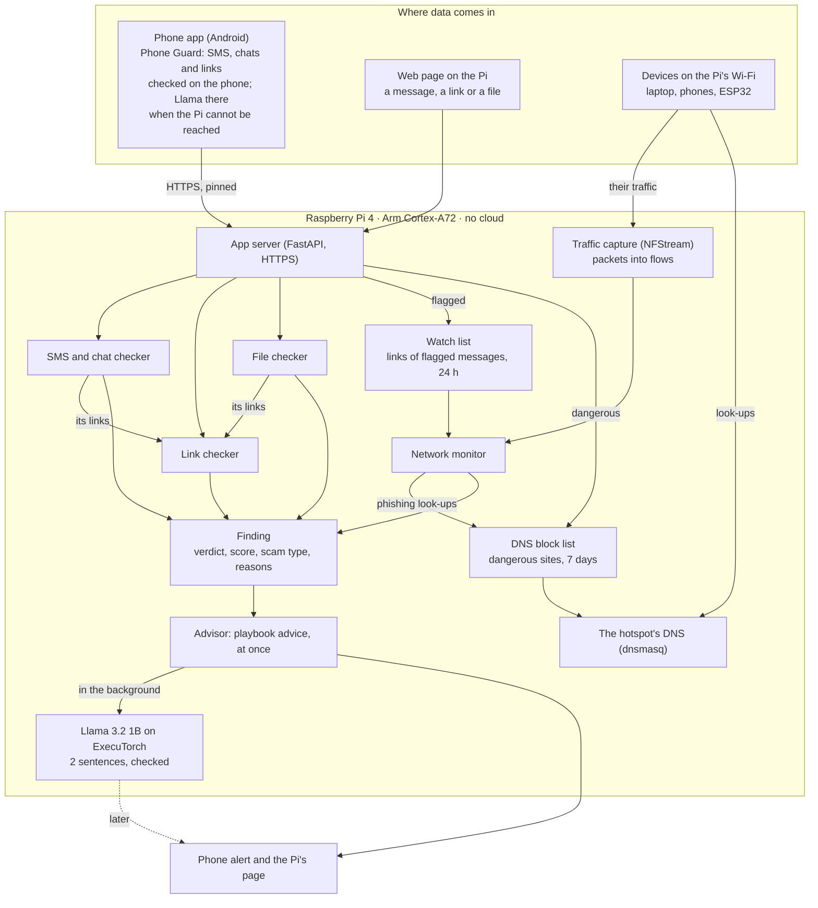
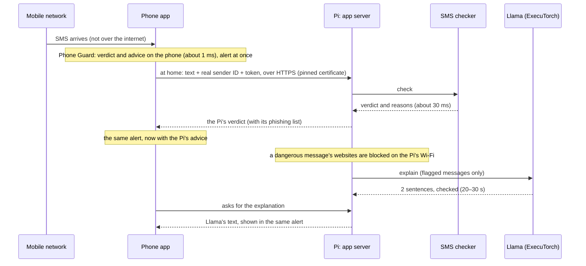
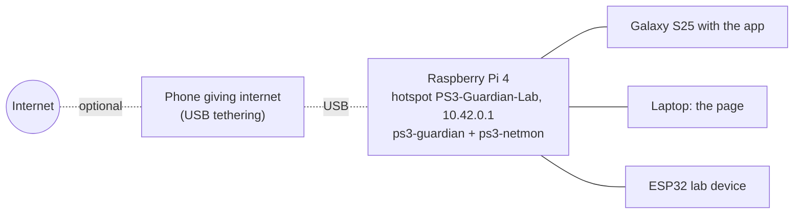

# Sajag (सजग): on-device threat, phishing and scam detection

**Arm Bharat AI-SoC Student Challenge 2026–27, Problem Statement 3** · Theme: Cybersecurity and Digital Safety · Phase 1, November 2026
**Team:** Piyush Singh (lead), Anshu Patra, Harshit Oraon

Sajag (Hindi for "alert, watchful"; called PS3 Guardian while it was built, which is why the repository keeps that name) is a security assistant for Indian homes that runs entirely on Arm edge hardware: a **Raspberry Pi 4** and an **Android phone**. It checks **SMS and chat messages**, **links**, **files that arrive in chats** and the **network traffic of every device on the home Wi-Fi**. Small, fast checkers give a verdict in milliseconds: safe, suspicious or dangerous. Then **Llama 3.2 1B**, deployed with **ExecuTorch** on the Pi's Arm CPU (and on the phone's, when the phone is away from home), explains each alert in plain English, a fixed playbook tells the user what to do, and the Pi's DNS stops scam websites from opening on its Wi-Fi. No message, file or traffic record is sent to any cloud service.

It has two parts. **Phone Guard**, on the Android phone, checks the owner's SMS, chats and links on the phone itself, anywhere, even with no network, and away from home explains its alerts with its own copy of the Pi's Llama. The **Home Hub**, on the Pi, protects every device on the home Wi-Fi: it watches their traffic, checks files, blocks scam websites, and runs Llama to explain alerts. At home the two work together.

---

## Start here

| | |
| --- | --- |
| **Technical report** | [report/sajag-phase1-report.pdf](report/sajag-phase1-report.pdf): the approach, the architecture, the algorithms, the results and the Phase 2 plan |
| **Demo video** | *link to be added* |
| **Results** | [eval/](eval/README.md): every measured number and how to reproduce it |
| **Guides** | [docs/](docs/README.md): installing the app, the hub, each part, the tests |
| **State of every part** | [docs/status.md](docs/status.md) |
| **Run it** | [section 11](#11-repository-layout-and-how-to-run-it) |

**The approach in three stages.** (1) A **Home Hub** on a Raspberry Pi 4 protects every device on the home Wi-Fi, including IoT devices that cannot protect themselves. (2) **Sajag on each phone** protects its owner anywhere, with the hub's own checks and the hub's own Llama running on the phone. (3) At home, each phone **feeds the hub** its owner's real messages (with consent), so the hub learns from every member of the household and can give every phone a better model. Phase 1 built and measured all three; Phase 2 grows the third.

| Folder | What is in it |
| --- | --- |
| [`android/`](android/) | The Sajag app (Kotlin): Phone Guard, Llama on the phone, the screens |
| [`app/`](app/) | The hub's app server and web page, HTTPS, DNS blocking |
| [`detectors/`](detectors/) | The checkers: `sms/` messages, `url/` links, `files/` files, `net/` network |
| [`advisor/`](advisor/) | Playbooks, prompts, the Llama service, the grounding checker, the grading tool |
| [`deploy/`](deploy/) | Llama's export with ExecuTorch and our C++ engine for the Pi 4 |
| [`esp32/`](esp32/) | The ESP32 lab IoT device |
| [`scripts/`](scripts/README.md) | Set-up, services, downloads, measuring tools, the phone export |
| [`eval/`](eval/README.md), [`docs/`](docs/README.md), [`tests/`](tests/), [`report/`](report/README.md) | Results, guides, 379 tests, the technical report |

**Branches:** `main` is the Phase 1 submission; `dev` is where Phase 2 work goes; the tag `phase1-submission` marks the version submitted on 23 November 2026.

---

## Contents

1. [At a glance](#1-at-a-glance)
2. [The problem and how we answer it](#2-the-problem-and-how-we-answer-it)
3. [Solution overview](#3-solution-overview)
4. [Hardware and set-up](#4-hardware-and-set-up)
5. [The components in detail](#5-the-components-in-detail)
6. [How it was built](#6-how-it-was-built)
7. [Results](#7-results)
8. [Privacy, safety and responsible design](#8-privacy-safety-and-responsible-design)
9. [Limitations](#9-limitations)
10. [Roadmap](#10-roadmap)
11. [Repository layout and how to run it](#11-repository-layout-and-how-to-run-it)
12. [Data, models and licences](#12-data-models-and-licences)
13. [Team](#13-team)

---

## 1. At a glance

| | |
| --- | --- |
| **Hardware** | Raspberry Pi 4 Model B, 4 GB (4× Arm Cortex-A72, 64-bit Linux), CPU only, no accelerator; a Samsung Galaxy S25 and teammates' Android phones; an ESP32 on an IoT Pro Kit as a lab IoT device |
| **Llama** | Llama 3.2 1B Instruct, Meta's SpinQuant INT4 checkpoint, exported with ExecuTorch (XNNPACK, 4-bit weights, 8-bit activations), ≈1.0 GB `.pte`, run by our own C++ engine on the Pi's Arm CPU; the same file runs on the phone with ExecuTorch for Android when the Pi cannot be reached |
| **What it checks** | SMS with their real sender IDs; WhatsApp and RCS chats from unknown numbers; links; PDF, Office, APK, zip and web files; the traffic of every device on the Pi's Wi-Fi |
| **What the user gets** | A verdict at once, from the phone itself, with the reasons and the steps to take (1930, cybercrime.gov.in); Llama's two-sentence explanation, from the Pi at home (20–30 s later) or from the phone away from it (about 4 s on the S25); scam websites blocked on the Pi's Wi-Fi |
| **Speed** | On the phone: a message in 2–11 ms on the Galaxy S25 (0.7 ms on a laptop-class CPU), and Llama's explanation in 3.6 s (5.2 s when the model loads first). On the Pi 4: SMS verdict ≈30 ms; link ≈1 ms; file ≈20 ms; network alert within about 30 s to 10 min, by kind; a new Llama explanation 18–31 s, a repeated one instant |
| **Measured** | **SMS:** F1 0.950 on held-out public messages; on 227 real Indian messages 96 of 100 scams caught, but 59–64% of normal messages flagged with the text and the senders we had (4% with ideal registered sender IDs is a projection, not a measurement); on the team's real traffic, 13% of SMS from registered sender IDs flagged, mostly marketing. **Links:** 81% of brand-new phishing sites caught with no lists; 1.1% of popular websites called dangerous. **Network:** all 10 network-level attacks in CIC-IDS2017 detected; on IoT-23's real IoT malware, 2 of 5 infected devices flagged, with no false alarm in 28.8 h of three real smart-home devices. **Files:** 21 of 21 test files right, no false alarm on 521 ordinary PDFs. **Phone Guard:** the same verdict as the Pi on all 16,272 test messages, and the same Llama prompt on all 8,833 of them that Llama explains. **Llama:** of the sentences users see, 72% supported by the evidence and 12% wrong (one grader) |
| **Security** | HTTPS to the Pi with a certificate each phone pins when pairing; a 128-bit pairing token on every request; message texts kept only for phones whose owner switched the study on |
| **Cloud use** | None. The phone decides on its own and talks to the Pi over the home Wi-Fi; the internet is needed only for the devices' own browsing and for refreshing the phishing list |
| **Code** | 66 Python files (≈12,700 lines), a 38-file Kotlin Android app, Sajag (≈5,500 lines, Phone Guard and Llama on the phone included), a C++ Llama engine, an ESP32 sketch; 379 automated tests as pytest counts them (273 test functions, some run with several inputs) |

---

## 2. The problem and how we answer it

**PS3 asks for** "an on-device AI system that detects cybersecurity threats, including network intrusions, malware behaviour and phishing or scam communications, running entirely on Arm-based edge hardware without cloud dependency". A Llama-family model must be the advisory component, deployed on-device with ExecuTorch.

| PS3 asks for | Our answer | Where |
| --- | --- | --- |
| Monitoring and classifying network traffic for anomalies and intrusions | Network monitor on the Pi, which is the Wi-Fi hotspot: scans, floods, password guessing, risky ports, beacons, made-up (DGA) names, DNS tunnels, phishing look-ups, each device's normal behaviour | [5.6](#56-network-monitor) |
| Detecting phishing URLs | Link checker: official sites, brand-imitation rules, a public phishing list kept on the Pi, a link model | [5.4](#54-link-checker) |
| Detecting scam SMS and fraudulent communications | SMS checker with the real sender ID read by the phone app; chats from unknown numbers; files that arrive in chats | [5.3](#53-sms-and-chat-checker), [5.5](#55-file-checker) |
| Explaining threats to non-expert users in plain language | Llama 3.2 1B writes two sentences, checked against the evidence before anyone sees them | [5.8](#58-advisor-playbooks-and-llama) |
| Recommending remediation actions | 25 playbooks: steps for every kind of alert, always shown word for word; and the Pi's DNS blocks scam websites on its Wi-Fi | [5.8](#58-advisor-playbooks-and-llama), [5.7](#57-messages-meet-network-traffic-and-dns-blocking) |
| Processing data locally without cloud services | Everything runs on the phone and the Pi; the phone's verdicts need no network at all, and the two talk over HTTPS on the home Wi-Fi | [8](#8-privacy-safety-and-responsible-design) |
| Llama via ExecuTorch on-device (required) | Llama 3.2 1B SpinQuant INT4, ExecuTorch release 1.5, XNNPACK, on the Pi 4's Arm CPU, and the same model on the phone's Arm CPU with ExecuTorch for Android | [5.8](#58-advisor-playbooks-and-llama) |
| Deliverables: source code, application, demo video, technical report | Source code and tests in this repository; the Android app and the Pi's web page; video and report for 23 November | [10](#10-roadmap) |

**Hardware choice.** The PS3 hardware list allows "Arm-based Android smartphones" and "Arm-based Linux devices". We use both: a Raspberry Pi 4 (an Arm-based Linux device, CPU only) as the home's security hub, and Android phones. No Hailo or AI HAT is used (the AI HAT+ fits only a Raspberry Pi 5). The Pi 4 is the harder target: its Cortex-A72 is Armv8.0, so ExecuTorch's prebuilt libraries do not run on it, and we built our own engine ([6](#problems-we-solved-along-the-way)). The same software should run unchanged on a Pi 5 (not tested yet).

**Example application areas from PS3 that we cover:** home network intrusion detection, scam SMS filtering, phishing link detection, IoT device behaviour monitoring (the ESP32), offline threat intelligence (the phishing list lives on the Pi), and a digital safety assistant for non-technical users. Two example areas are not covered: scam call filtering and small-business networks.

---

## 3. Solution overview

### Design principles

1. **Small checkers decide, Llama explains.** Rules and small models give the verdict in milliseconds. A 1B language model is slow on a Pi 4, can be wrong, and could be talked into "safe" by a scammer's text, so it never decides. It only explains, and its sentences are checked against the evidence it was given.
2. **Nothing leaves the home network.** The phone decides on its own and sends to the Pi over the Pi's own Wi-Fi; neither needs an outside service for any check.
3. **Two parts that also work apart.** Phone Guard protects its owner anywhere; the Home Hub protects every device at home. The phone runs the Pi's own checks, copied from the same Python code, so they agree.
4. **Indian scams first.** TRAI sender IDs, `.bank.in` and `.gov.in`, Indian brands, KYC, UPI, OTP and APK scams, the 1930 helpline.
5. **Answer at once, explain after.** The phone's verdict and the playbook's advice appear immediately; Llama's explanation replaces it in the same alert 20–30 s later.
6. **Protect, not only detect.** The Pi's DNS refuses the websites of dangerous messages and the phishing sites devices look up, with an undo on the page.
7. **Measure everything on real hardware and real data,** and report the numbers, including the bad ones.
8. **Defensive only.** No attack tools; the lab device's test modes are harmless imitations, and public malware traffic is replayed from files, never sent.

### Architecture



Every checker writes the same **finding**: a verdict, a score from 0 to 1, a scam type and short reasons. A score of 0.5 or more is suspicious and 0.8 or more is dangerous, for every checker. The advisor never needs to know which checker made a finding.

### One SMS, from arrival to explanation



If the Pi cannot be reached, the phone's own verdict and alert stand, Llama on the phone explains the alert a few seconds later (once Llama has been copied from the Pi), and the message waits on the phone (up to 500) until the Pi can add its phishing list. If the message is flagged, the websites of its links go on the watch list for 24 hours: if any device on the Wi-Fi then opens one, the network monitor raises "Link from a scam message opened" and the website is blocked.

---

## 4. Hardware and set-up

| Device | Role |
| --- | --- |
| **Raspberry Pi 4 Model B, 4 GB** | The hub. Raspberry Pi OS Lite 64-bit (Debian 13), Python 3.13, booted from a 128 GB USB 3.2 drive. Runs two services: `ps3-guardian` (the app server and the Llama service) and `ps3-netmon` (the network monitor). It is also the Wi-Fi hotspot `PS3-Guardian-Lab` (10.42.0.1) and its DNS server |
| **Samsung Galaxy S25 and teammates' Android phones** | Run the companion app with Phone Guard: check SMS, chats and links on the phone, show alerts and network alerts, share files to the Pi |
| **ESP32 DevKit on the IobiT IoT Pro Kit** | A small IoT device on the lab Wi-Fi: sends DHT11 and BMP180 readings every 15 s; harmless test modes imitate an infected device |
| **A second phone on the Pi's USB port** | Gives the Pi internet by USB tethering, only so the devices on the lab Wi-Fi can browse |
| **Laptop** | Opens the Pi's page; used to export the model, build the C++ engine (WSL2) and build the Android app |



- **Solid lines** (the Pi's own Wi-Fi) are what detection needs. **Dashed lines** (the internet) are only for the devices' browsing and for refreshing the phishing list.
- `scripts/setup_gateway.sh` makes the Pi the hotspot with NetworkManager, and `scripts/setup_dns_block.sh` adds DNS blocking. Both undo themselves after 10 minutes unless confirmed, so a wrong setting cannot lock you out. The hotspot also tells Android phones it is metered, so they hold back big background downloads.
- Both services start at boot (systemd) and restart by themselves if they stop.

---

## 5. The components in detail

### 5.1 Android companion app

A complete Android Studio project in Kotlin (`android/`, package `com.ps3guardian.app`, version 3.2), minimum Android 8.0 (API 26), target API 36, WorkManager 2.12.0. Since version 3.0 the app is called **Sajag** (सजग, Hindi for "alert"), and it calls the Pi the **Home Hub**. Installed from Android Studio over USB, because Play Protect in India blocks apps with SMS permissions installed from a file.

| Part | What it does |
| --- | --- |
| Phone Guard (`guard/*.kt`, `PhoneGuard.kt`) | The Pi's message and link checks, in Kotlin: text cleaning, the SMS model, the India and sender rules, the link checker with the link model, the scam types and the playbooks' steps, and Llama's prompt and answer checks, from 3.5 MB of data copied from the Pi by `scripts/export_phone_guard.py` ([docs/phone-guard.md](docs/phone-guard.md)). Every message is judged here first, with no network |
| Llama on the phone (`PhoneLlama.kt`, `PhoneExplainWorker.kt`, `guard/Llama.kt`) | When the Pi cannot be reached, Llama 3.2 1B explains the phone's alert on the phone: the Pi's own model files, copied once from the paired Pi ("Get Llama from the Pi", about 1 GB, each file checked against the Pi's SHA-256), run by ExecuTorch 1.5.1 for Android with the Pi's prompt; the answer passes the Pi's checks before it replaces the alert's text |
| SMS receiver (`SmsReceiver.kt`) | Reads every incoming SMS with its **real sender ID** (`JD-HDFCBK-S` or a 10-digit number) and sends it to the Pi. Typed sender names are unreliable; the real ID is what separates a bank alert from a scam |
| HTTPS, pinned (`PiClient.kt`, `Tls.kt`) | The app talks to the Pi only over HTTPS, and trusts exactly one certificate: the one its owner confirmed when pairing, by comparing its fingerprint with the one the Pi prints. No plain HTTP at all |
| Waiting list (`Checker.kt`, `FlushWorker.kt`) | Keeps up to 500 messages while the Pi is out of reach and sends them later (every 15 minutes, when the app opens, and after any answered SMS) |
| Chats (`ChatListener.kt`, `ChatApps.kt`) | With notification access switched on, checks RCS chats (Google and Samsung Messages) and WhatsApp messages from senders who are not saved contacts, where scam chats come from. A contact's chat is checked only when it names an app file (`Wedding_Invitation.apk`), and then only the file's name is sent |
| Check with Sajag (`ShareActivity.kt`) | Share a file (PDF, Office, APK, zip) or a message's text from WhatsApp or any app, or paste one on Home: the Pi checks it (a text is also checked on the phone at once) and the alert's own screen shows the verdict, steps and Llama's text |
| Alerts (`Notifier.kt`, `ExplainWorker.kt`) | A notification for every flagged message ("Dangerous · Fake bank KYC message"), with the advice at once and Llama's explanation swapped in when ready, and two buttons: **What to do** and **Call 1930** |
| Screens (`MainActivity.kt`, `*Page.kt`, `AlertActivity.kt`, `SetupActivity.kt`, `History.kt`) | App 3.0: **Home** (protected or not, the Home Hub and offline explanations at a glance, the newest results), **Alerts** (every checked message by day, all, scams or safe), **Network** (the devices riskiest first, the network alerts), **Settings**; a screen per alert (what is happening, what to do now with 1930 and cybercrime.gov.in, why it was flagged, the message with its links broken); a set-up in three steps; since app 3.1 (update 47) each notification names its message (the sender, the start of the message with its links broken, the time it arrived); a lock screen set to hide sensitive content shows only the verdict and the scam type. Charcoal and ivory, with red, yellow and green only for verdicts ([docs/android-companion.md](docs/android-companion.md#part-m-app-30-sajag-update-46)) |
| Network alerts and devices (`NetWorker.kt`, `NetAlerts.kt`, `Devices.kt`) | About once a minute, asks the Pi for new network alerts and notifies; lists the devices on the lab Wi-Fi with a risk level (AT RISK, CHECK, OK) |
| Settings | What to check (SMS, WhatsApp, Messages chats, network alerts), the Home Hub (pairing with its certificate, a connection test), offline explanations, the study switch ("Help improve detection", off until its owner switches it on), the phone's name (each phone's messages are counted apart) and an activity log with every timing |

Permissions: receive SMS, internet (needed for any network connection, including the home Wi-Fi), notifications, and notification access only if the user switches chats on.

### 5.2 App server and web page

A FastAPI application (`app/server.py`) on the Pi, served by `app/serve.py` on **HTTPS (port 8443)** with the Pi's own certificate, made once by `scripts/run_pi.sh`. Port 8000 stays plain HTTP only for the Pi's own scripts and the ESP32's readings: from any other machine it takes nothing else, and the page's plain address redirects to HTTPS. Every call needs the 128-bit pairing token (only the page itself, which holds no data, opens without it); ten wrong tokens in a minute block an address for a minute. The ESP32 has its own token, good only for posting readings.

| Endpoint | What for |
| --- | --- |
| `POST /sms` | The phone app: a message with its sender ID and the study switch. Logs the result (see [8](#8-privacy-safety-and-responsible-design)) |
| `POST /check` | The page: a message or a single link |
| `POST /url` | One link |
| `POST /file` | A file, as the raw request body; checked in memory, never stored |
| `GET /explain/{id}` | Llama's checked explanation, when ready |
| `GET /alerts`, `GET /devices` | Network alerts; devices on the lab Wi-Fi with their risk |
| `GET /blocked`, `POST /blocked`, `POST /blocked/undo` | Websites the Pi's DNS refuses; block one by hand; unblock one |
| `POST /iot`, `GET /iot`, `POST /iot/mode` | The ESP32's readings and its test modes |
| `GET /health`, `GET /` | Status; the phone-friendly page (light and dark) |

The page lets anyone with the pairing token paste a message or link, check a file, see network alerts with Llama's text, see the devices and their risk, block and unblock websites, and run the ESP32's test modes.

### 5.3 SMS and chat checker

`detectors/sms/`: one score from 0 to 1, built in steps that each raise or lower it.

1. **Red-flag rules for India** (`rules_india.py`): KYC, OTP, UPI, an `.apk` file, urgency ("blocked today"), money and prizes, a bank's or the government's name with a link that is not on `.bank.in` or `.gov.in`, talk of an OTP, PIN or password, and whether the message asks you to share one. They give the reasons and a few numbers for the model.
2. **Text model** (`train_baseline.py`): the text is cut into pieces of 2–5 letters (TF-IDF, up to 20,000 pieces) plus the rules' numbers; logistic regression gives a fraud score. Trained on 6,053 public messages (section [12](#12-data-models-and-licences)); the team trained it on the Pi itself. The app refuses to start with the small sample model.
3. **Sender ID** (`senders.py`): India's TRAI rules require businesses to send from registered IDs. The odds of fraud are multiplied by 0.02 for a service, transactional or government ID (`-S`, `-T`, `-G`), by 0.1 for a promotional one (`-P`), and by 4 for a personal number that sends links, money, urgency, bank words or OTP talk. The multipliers come from TRAI's rules and were set before any test, not fitted to one. Two **sender rules** (update 37) close part of the door this opens: no sender ID clears a message that asks you to share an OTP or PIN, or that names a bank and carries a link the link checker does not call safe (`cap`); and a risky message naming a bank, payment app or government office gets no discount from a sender ID that does not look like that organisation's (`brand`).
4. **Links**: every link goes to the link checker. A dangerous link multiplies the odds by 3, a suspicious one by 1.5, and links only to official sites by 0.3. An `.apk` link, a site on the phishing list or a brand's name on someone else's site makes the message dangerous whoever sent it.
5. **Scam type and claimed sender**: rules pick the scam type, which chooses the playbook (KYC, OTP theft, delivery fee, digital arrest, lottery, job task, utility disconnection, APK link, phishing link, promotional, …). The organisation a message claims to be comes from a fixed list (`brands.py`), never from the message itself.

**SMS model v2** (`train_v2.py`): three classes (fraud, marketing, normal), trained with the team's own labelled messages and trusting marketing only from registered sender IDs. It was compared with v1 under a rule fixed before the test, and did not pass: it missed the one scam from a registered sender ID that v1 caught. The app keeps v1 ([docs/sms-model-v2.md](docs/sms-model-v2.md)).

### 5.4 Link checker

`detectors/url/`: about a millisecond per link, with no network.

1. **Read the address** (`links.py`, offline public-suffix list): the registered domain (`sbi.co.in.kyc-check.xyz` is really `kyc-check.xyz`), punycode, and websites hidden inside Google redirects, Google Translate and Google's AMP links.
2. **Sure signs, dangerous on their own:** an `.apk` file; the `@` trick; the site is on the phishing list; a brand's name on someone else's site with sign-in words, a cheap ending, free hosting or a fake prefix.
3. **Says nothing by itself:** short links, WhatsApp and Telegram links, shared files and forms. The sender and the text decide.
4. **Official:** `.bank.in`, `.gov.in`, `.nic.in`, `.fin.in`, the brands' own endings (`.sbi`, `.google`) and 157 domains that belong to 33 brands and organisations.
5. **Otherwise the link model** (`model.py`): logistic regression on 2–5-letter pieces of the registered domain plus 7 numbers (length, digits, hyphens, letter entropy, vowels, consonant runs, ending), trained on 996,256 domains. Its score is then weighted for what it cannot see: an IP address ×6, a brand's name ×5 (×3 in a subdomain), look-alike letters ×3, sign-in words ×2, many subdomains ×1.5, one of the 10,000 most visited websites ×0.1.

**The phishing list** (`intel.py`): Phishing.Database, about 392,000 phishing domains still online, kept in a small SQLite file on the Pi and refreshed by `scripts/get_url_data.py`. Official sites, popular sites and shared services (free hosting, Google Drive) are never listed whole, so one bad page cannot block a whole service.

**Why the model reads only the domain:** in the main public dataset every legitimate URL is a bare home page while phishing URLs have paths. A model that reads whole URLs learns "has a path means phishing", and every genuine SMS link has a path. Rules handle paths instead.

### 5.5 File checker

`detectors/files/`: about 20 ms per file on the Pi. The file is kept in memory, never stored, never opened in a reader and never run.

1. **What is it really?** The first bytes say what a file is, whatever its name. An app or program named `Invitation.pdf`, a double ending (`Card.pdf.apk`) or a hidden right-to-left character is a disguise.
2. **Checks for its type:**
   - **APK:** dangerous when it comes in a chat. Its permissions are named when OTP thieves need them (read SMS, control the screen, read notifications).
   - **PDF:** JavaScript that runs on opening, launch commands, files hidden inside (checked too), forms that send data. Read only from the PDF's own dictionaries and object streams: picture and font bytes contain `/JS` by chance about 0.06 times per MB. Harmless scripts do not count: Acrobat's form helpers, page jumps, KiCad's schematic menus (recognised by a fingerprint of KiCad's own script).
   - **Word, Excel, PowerPoint:** macros, templates or objects loaded from the internet, DDE, programs inside embedded objects.
   - **Zip:** a password lock, apps inside, and up to 20 files inside checked like files. RAR and 7-Zip cannot be opened: suspicious.
   - **Web page saved as a file:** a password box (a fake sign-in page that needs no website), redirects, scripts.
3. **Its links** go through the link checker; e-mail and phone links are skipped.

Limits for the Pi's sake: 25 MB per file, 50 MB unpacked (against zip bombs).

### 5.6 Network monitor

`detectors/net/`, service `ps3-netmon`. Because the Pi is the hotspot, every device's traffic passes through it. The monitor reads **who talks to whom, when and how much, never the content**.

| Block | What it does |
| --- | --- |
| Traffic capture (`flows.py`, NFStream 6.6) | Turns packets into flows: one conversation, its addresses, ports, bytes, packets, duration and server name |
| Behaviour rules (`rules.py`) | Port scans; network sweeps (many machines tried on one port, mostly without answer); floods and slow DoS; password guessing on SSH, FTP, Telnet, e-mail and databases; a home device connecting out on ports malware uses (Telnet, IRC) |
| Beacons (`rules.py`) | A device checking in with a server at regular times (at least 10 new connections, 30 s or more apart), only for servers outside the device's normal |
| Names looked up (`dns.py`) | A site on the phishing list; many random-looking names at once, judged by a **DGA model** (malware searching for its controller: 5 names in 10 minutes); long unique sub-names (data hidden in DNS); a website from a flagged message |
| Each device's normal (`baseline.py`) | For each small device: connections, data, servers, ports and look-ups per 5 minutes. After 2 hours of learning, a jump far above its own normal with many new servers is reported. Laptops and phones are left out, because they change with their users |
| Once per 10 minutes (`engine.py`) | The same problem is reported once per 10 minutes, so an attack gives a handful of alerts, not thousands |
| Watched time (`monitor.py`) | Counts the hours watched and with traffic, for false alarms per day; restarts the capture if it gets stuck |
| Replay (`replay.py`) | Feeds public captures (IoT-23's real IoT malware) through the same engine, from files, and scores the alerts against the dataset's labels |

### 5.7 Messages meet network traffic, and DNS blocking

When a message is flagged, the app server puts its websites on a **watch list** for 24 hours (`scamlinks.py`). If a device on the Wi-Fi then looks one up, the monitor raises **"Link from a scam message opened"**, naming the device and when the message was flagged. This catches links the link checker alone rates safe: real Indian scams use short domains that look like genuine bulk-SMS link domains, and the sender and text gave them away.

**DNS blocking** (`app/dns_block.py`, update 40). The Pi is the DNS server of its hotspot, so it can refuse to look a website up; then the page does not open on any device on the Wi-Fi. Blocked automatically for 7 days: the websites of a dangerous message, a phishing site a device looked up, and a website from a flagged message that a device opened. Websites blocked by hand on the page stay blocked until unblocked. Official, popular and shared sites are never blocked. The app and the monitor only write a list; systemd runs a small root helper whenever it changes, which keeps only valid names and makes the hotspot's dnsmasq answer NXDOMAIN for each name and every name under it. **Unblock** on the page undoes a block, and that website is not blocked automatically again. Set up on the Pi on 16 November: its self-test saw the Pi's DNS refuse a blocked website and answer it again once unblocked ([docs/dns-blocking.md](docs/dns-blocking.md)).

Every device on the lab Wi-Fi also gets a **risk level** from its alerts of the last 24 hours (AT RISK, CHECK, OK), on the page and in the app.

### 5.8 Advisor: playbooks and Llama

**Finding → playbook → instant advice → Llama → answer checker → explanation.**

- **Playbooks** (`advisor/playbooks/*.md`): 25 short files, one per kind of problem: 11 for messages and links (bank KYC, OTP theft, delivery fee, digital arrest, lottery, job task, utility disconnection, APK link, phishing link, promotional spam, other suspicious messages), 3 for files and 11 for the network (port scan, network scan, flood, password guessing, risky port, beacon, DGA names, DNS tunnel, phishing look-up, unusual device, scam link opened). Each has a title, a severity, the steps to take, and three lines only Llama sees: who the scam pretends to be, what it wants, and one checked fact. **The steps shown to users always come from the playbook, word for word.**
- **Instant advice** (`advise.py`): headline, what, why (the checker's reasons) and steps, shown at once.
- **Prompt** (`prompt.py`, version 5): the playbook's facts, the checker's red flags, the claimed organisation from a fixed list and, since update 47, what this message says in fixed words ("says your electricity will be cut off", "mentions ₹25,000", "asks you to pay money", from `detectors/sms/says.py`), **never the message text**, so a scammer's words cannot steer Llama and the explanation is about this message, not only its scam type. Worked examples (English and Hindi) instead of rules, because a 1B model copies examples far better than it follows instructions. Network alerts have their own prompt and examples.
- **Llama 3.2 1B Instruct**, Meta's SpinQuant INT4 checkpoint, exported with ExecuTorch release 1.5 (`export_llm`, XNNPACK): 4-bit weights in groups of 32 with 8-bit dynamic activations, 8-bit embeddings and output layer, a KV cache, the custom SDPA op, 2,048 tokens of context. The `.pte` is about 1.0 GB. The same file also runs on the phone (update 44): the app copies it from its paired Pi (`GET /llama`) and runs it with ExecuTorch 1.5.1's Android library when the Pi cannot be reached, with the same prompt and the same answer checker ([docs/phone-guard.md](docs/phone-guard.md#llama-on-the-phone-update-44)).
- **Our C++ engine** (`deploy/advisor_server/`, driven by `llm_native.py` and `llm_service.py`). It is built for the Cortex-A72 with the Arm GNU toolchain 14.3 (`-march=armv8-a -mtune=cortex-a72`), and:
  - keeps the model loaded;
  - reads the fixed start of the prompt (system text and worked examples) once and reuses it from the KV cache, in fixed 32-token pieces so an answer never depends on earlier alerts;
  - writes exactly 2 sentences with greedy decoding;
  - saves answers, so a repeated alert is explained instantly.
- **Answer checker** (`validator.py`): rejects an answer that contradicts the verdict ("this is safe") or is in the wrong language; drops any sentence with a phone number or link not on an allowlist; keeps at most two complete sentences; removes hedging when the checker is confident and fixes known wording slips (wrong KYC expansions). Since updates 38 and 38b it also **holds every sentence to its evidence**: a sentence is dropped if it has a number or names an organisation the case does not have, says "never" or "always" where the case does not, claims where the message's link goes, or states a rule about what real companies do that the case's fact does not state. A dropped first sentence is replaced by the playbook's summary and a dropped second one by the checker's red flags; a rejected answer leaves the playbook text. Every sentence of 100 answers was graded by hand ([7](#llama-on-the-pi-4-evalresults_pi4md-and-docsllama-gradingmd)).

### 5.9 ESP32 lab device

`esp32/ps3_lab_device/` (Arduino): the ESP32 joins the lab Wi-Fi as an ordinary smart sensor and posts DHT11 and BMP180 readings every 15 s. From the Pi's page, four **harmless test modes** make it behave like an infected IoT device:

| Test | What the ESP32 does | Alert | When |
| --- | --- | --- | --- |
| DGA | a made-up name such as `kqxzvbtrwmlp.com` every 6 s | DANGEROUS: malware looking for its controller | after about 30 s |
| Fake bank site | looks up `sbi-kyc-update-verify.xyz` every 30 s | DANGEROUS: device opened a phishing website (and the website is blocked) | at the first look-up |
| DNS tunnel | a 30-letter sub-name every 4 s | DANGEROUS: data hidden in DNS look-ups | after about 2 minutes |
| Beacon | fetches `http://example.com/` every 60 s | SUSPICIOUS: device calling home at fixed times | after about 10 minutes |

Nothing is attacked: the names do not exist, and the beacon fetches IANA's example page. Every test stops by itself.

---

## 6. How it was built

### Timeline

| Date (2026) | Milestone |
| --- | --- |
| 25 September | Plan: a cascade of fast checkers feeding a Llama advisor, sized for the Pi 4 |
| 19–23 October | **Track A:** SMS detector baseline. **Step 2:** the path message → finding → advisor → app, end to end. **Track B:** Llama 3.2 1B exported with ExecuTorch and measured on the Pi 4. **Step 3:** the fast advisor: persistent service, native C++ engine, prompt v4 |
| 24–25 October | India SMS test set (227 real messages); sender-aware scoring; the Android companion with real sender IDs, a waiting list and auto-start; chats from WhatsApp and RCS |
| 25–26 October | Phishing link checker (rules, public list, link model) |
| 26 October | Network detector: behaviour rules, DNS checks, DGA model, each device's normal; evaluated on CIC-IDS2017 |
| 31 Oct–1 Nov | The Pi becomes the Wi-Fi hotspot, with a second phone for internet; the ESP32 lab device; all four test modes caught live; false beacon alerts fixed |
| 1–3 November | Llama explains network alerts; network alerts and device risk in the phone app; messages meet network traffic |
| 3–5 November | Measurement tools; a busy hour on the lab Wi-Fi; its 5 false alarms fixed; no false alarm in 20,960 flows afterwards |
| 7–13 November | The file checker, after our mentor asked about documents arriving in WhatsApp; measured on the team's everyday files and 521 ordinary PDFs |
| 14 November | SMS model v2 tested on the team's labelled messages, twice: it did not pass the rule set in advance, so the app keeps v1. A hard external review of the whole project |
| 14–15 November | After the review: a pairing token on every request and study phones; sender rules measured on the Pi; Llama's sentences held to their evidence and 100 answers graded by hand; HTTPS with a pinned certificate, the phone's study switch and a proper package name; DNS blocking on the hotspot; the IoT-23 replay |
| 16 November | DNS blocking set up and tested on the Pi; IoT-23's real IoT malware replayed on the Pi |
| 21 November | Phone Guard: the message and link checks on the phone itself, checked to decide as the Pi does, and running on the Galaxy S25; Llama on the phone for alerts away from the Pi |
| 22 November | Llama on the S25 tested with the Pi out of reach: an explanation in 3.6 s, five to eight times faster than on the Pi 4. The phone app becomes **Sajag**: four pages, a screen per alert, a set-up in three steps. Prompt v5: Llama is told what each message says, in fixed words; each notification names its message. Accuracy test: 755 of 859 real Indian scam campaigns flagged (87.9%), on messages never used to build Sajag |

The work reached the Pi in 50 numbered updates. Each update was a tested git bundle, pulled on the Pi and pushed to GitHub. Every update ran the full test suite first, and every result in this document comes from a script in the repository. Per-part status: [docs/status.md](docs/status.md).

### Problems we solved along the way

1. **The ExecuTorch Python wheel cannot run on a Pi 4.** It stopped with "Illegal instruction". We disassembled its libraries with our own tool (`deploy/tools/check_arm_isa.py`) and found 43 Armv8.1 atomic instructions in the custom LLM ops library, built for Armv8.2. The Pi 4's Cortex-A72 is Armv8.0. Fix: our own C++ engine built from source for `armv8-a`, needing no PyTorch on the Pi.
2. **Llama was too slow per alert.** It took 42.5 s with `llama_main`, including 11.7 s just to load. Fix: the model stays loaded, the fixed prompt start is read once, answers are 2 sentences, and repeats come from saved answers. A new alert now takes 18–25 s; a repeat is instant.
3. **Reusing the KV cache changed answers slightly.** Kernels round differently by call length. Fix: prompts are read in 32-token pieces at fixed positions; the same prompt now gives the same logits on the Pi (CRC-32 checked).
4. **A 1B model invents things, and the checker could not see it.** It caught forbidden forms ("this is safe", links), not invented facts. Fix: grounding checks hold each sentence to its evidence, and 100 answers were graded sentence by sentence. Reading them showed the checks themselves had faults: the "never" check dropped true sentences, and Llama turned the `.bank.in` fact around. Both were fixed (update 38b) and measured on the graded sentences.
5. **Public SMS data does not look like Indian inboxes.** On 227 real Indian messages, the text model flagged 64% of normal ones (OTPs, bank alerts, deliveries), because the public data has almost none. Fix: the phone app reads the real sender ID and TRAI's rules weight it. Measured on the team's real traffic, 13% of SMS from registered sender IDs are still flagged, mostly marketing; SMS model v2, trained on those messages, fixed that but missed a scam, so it is not used yet.
6. **The link model learned a shortcut.** Legitimate URLs in the public dataset had no paths. Fix: a domain-only model, with Chrome's top million websites as legitimate examples. Before that, 19 of 25 genuine Indian domains were flagged; after it, 5.
7. **Network false alarms on real traffic.** Keep-alive pings looked like beacons; a browser's spare connections looked like scans; a busy laptop looked like an infected device. Each fix came from a real alert on the lab Wi-Fi, has a test made from that alert, and was checked again on CIC-IDS2017.
8. **File false alarms on everyday files.** Random bytes in pictures looked like PDF script keys; e-mail links looked like the "@" trick; a KiCad schematic's menus looked like hidden code. Fix: read only the PDF's structure, skip e-mail links, and recognise harmless scripts. False alarms on the team's everyday files fell from 6 to 1.
9. **To see every device's traffic, the Pi had to be the Wi-Fi.** At first the Pi was just another device on a phone's hotspot. Fix: the Pi makes its own Wi-Fi, with a phone on its USB port for internet.
10. **The phone and the Pi talked in plain HTTP,** so anyone on the Wi-Fi could read the token and the messages. Fix: HTTPS with the Pi's own certificate, pinned by the app when its owner compares the fingerprint. The ESP32, which cannot pin, keeps plain HTTP only for its readings.
11. **The Pi detected but did not protect.** "Link from a scam message opened" came after the page had loaded. Fix: the Pi's DNS refuses dangerous websites on its Wi-Fi, with an undo on the page and a set-up that removes itself unless confirmed.
12. **Away from the Pi's Wi-Fi the phone could only wait.** Fix: Phone Guard. The Pi's checks were copied to Kotlin, with their data exported from the same Python code, and a test on the Pi fails if the two drift apart. Python and Kotlin read regular expressions differently (Python's `\b` and `\w` know Hindi letters, Java's do not), so the phone translates each pattern; 16,272 test messages then got the same verdict from both.

### Tools

Python 3.13, scikit-learn, NumPy, FastAPI, uvicorn, NFStream 6.6, tldextract; ExecuTorch release 1.5 with XNNPACK (and its Android library 1.5.1), the Arm GNU toolchain 14.3, WSL2; Kotlin, Android Studio, WorkManager; Arduino IDE 2 with the ESP32 core; dnsmasq and systemd on the Pi; pytest (364 tests, with a fake Llama so tests need no model).

---

## 7. Results

All numbers are measured, with the scripts in this repository, except where marked as a projection. Full tables: [eval/](eval/).

### Accuracy test, 22 November ([eval/results_accuracy.md](eval/results_accuracy.md))

The app's message checks as the phone runs them (the same code, compared on 16,272 messages), on labelled messages. In brackets: 95% intervals.

| Set | Scams flagged | Normal flagged |
| --- | --- | --- |
| *Fishing for Smishing*, India: 859 scam campaigns reported from Indian mobile numbers, never used to build Sajag | **755 of 859 (87.9%, 86–90%)**; banking 97%, telecom 93%, delivery 11 of 11, government 70%, other kinds 68% | – |
| Public messages the model never trained on (1,816) | 304 of 318 (95.6%) | 18 of 1,498 (1.2%) |
| India test set (227; senders typed by hand; used while building the rules) | 96 of 100 | 44 of 75 (59%): with a real registered sender ID 1 of 10, with a typed name 38 of 47 |

Of the 96 caught India scams, the alert's title names the right kind of scam for 54%, a general kind for 30% and the wrong kind for 16% (mostly "Fake bank KYC" for reward-point and SIM-card scams). Still to come: the false alarms on the team's real messages, Llama's prompt v5 graded against v4 on the same cases, and a live test on the S25 ([docs/accuracy-test.md](docs/accuracy-test.md)).

### SMS ([eval/results_sms.md](eval/results_sms.md))

| Test | Result |
| --- | --- |
| Held-out public messages (1,816; 30% of 6,053, after removing duplicates) | F1 0.950; precision 0.941, recall 0.959; false alarms 1.27% (19 of 1,498); missed 4.1% (13 of 318) |
| 227 real Indian messages, never used in training (100 fraud, 52 marketing, 75 normal; 22 in Hindi or Hinglish), text only | 94 of 100 fraud flagged, but 48 of 75 normal messages too (64%) |
| The same, with the senders the sheet has | 44 of 75 normal messages flagged (59%) |
| The same, with links checked (v1 as the app runs it) | 96 of 100 fraud caught |
| *Projection:* every genuine message given its ideal registered sender ID | 3 of 75 normal messages flagged (4%); 17 (23%) if the IDs had no suffix |
| First real SMS through the app (25 October) | An Airtel pack notice scored 0.856 (dangerous) on its text alone and **0.106 (safe)** with its real sender ID `AE-AIRTEL-S` |
| The team's real traffic (2,674 messages from three phones, 14 November) | SMS from registered sender IDs: 35 of 273 flagged (13%), of those labelled 14 marketing, 2 normal, 1 fraud; false alarms on normal messages at least 0.9 and at most 7.9 per 100 received, until the flagged ones are all labelled. With the S25's messages labelled too (15 November): 23 of 181 genuine messages from registered IDs flagged (13%) |
| Sender rules on the Pi (226 messages from registered IDs, India set and team) | `cap` and `brand`: no false alarm added, switched on; `suffix`: 7 more false alarms, left off. v1 still lets through 3 of 4 team scams from registered IDs |
| SMS model v2 against v1 (94 labelled team messages, rule fixed in advance) | From registered sender IDs on held-out phones, marketing and normal flagged: 10 → 0; but v2 missed the one scam from a registered ID that v1 caught. **v2 does not pass; the app keeps v1** |

### Links ([eval/results_url.md](eval/results_url.md))

Held out by domain: no test domain was seen in training.

| Test | Flagged | Dangerous |
| --- | --- | --- |
| Brand-new phishing sites (Phishing.Database hosts, no lists) | **80.9%** | 69.7% |
| Popular websites (Chrome top 1M) | 7.6% | **1.1%** |
| Phishing hosts using an Indian brand's name | 20 of 21 | 17 of 21 |
| Popular `.in` websites | 4.8% | **0.3%** |

ROC AUC of the link model alone: 0.920.

### Network ([eval/results_net.md](eval/results_net.md))

**CIC-IDS2017** (5 days of a company network, 2,830,743 flows, 40.7 hours, fed in order as one Pi would see them):

- **All 10 attacks that show in the shape of the traffic were detected, 7 within the first minute:** FTP and SSH password guessing, four DoS attacks, a DDoS, a port scan, an infiltration (caught when it scanned), and a bot (caught as a beacon after 10 check-ins).
- **Missed by design:** Heartbleed and three web attacks. They look like ordinary web connections; seeing them needs packet content, which the monitor never reads.
- **False alarms:** 144 in 40.7 hours, 116 of them beacons. The data's timestamps are rounded to whole minutes, which makes many connections look regular. Without beacons: 28 in 40.7 hours for about a dozen machines.

**DGA model:** 89.8% of held-out machine-made names caught, 0.35% of real names flagged (at 0.9); ROC AUC 0.997.

**The Pi's own lab Wi-Fi:**

| Test | Result |
| --- | --- |
| The ESP32's four test modes | All caught live, each naming `esp32-lab` |
| A busy hour (30 websites, YouTube, Windows Update) with the earlier rules | 5 false alarms in 36 minutes, all fixed |
| The same activities after the fixes | **No false alarm in 20,960 flows** (1.1 hours with traffic, including 14,716 flows in 15 minutes) |

**IoT-23** (real IoT malware and real smart-home devices, labelled by the Stratosphere Laboratory; the rules were not tuned on it), replayed on the Pi from the labelled logs ([eval/results_net.md](eval/results_net.md#iot-23-real-iot-malware-16-november-2026)):

| Test | Result |
| --- | --- |
| Three smart-home devices: a Philips Hue lamp, an Amazon Echo, a Somfy door lock (28.8 h) | **No false alarm** |
| Five infected devices: two Mirai, Hakai, Torii, a trojan | **2 of 5 flagged** (4 of 10 labelled behaviours): both Mirai devices, by risky-port alerts on their controller traffic (IRC for one of them) and a flood; one of them within about a minute |
| Missed | Torii's 16 tries in a day and the trojan's 6 downloads, on ordinary web ports; Hakai's 8,222 tries at a controller that never answered, on port 50 |
| The same without the 2 hours of learning per device | Nothing more caught; 30 false alarms on the smart-home devices (1 an hour) |

The monitor catches loud behaviour and controllers on telltale ports, not quiet controllers on web ports: those need the content or lists of known controller addresses.

### Llama on the Pi 4 ([eval/results_pi4.md](eval/results_pi4.md) and [docs/llama-grading.md](docs/llama-grading.md))

| | Result |
| --- | --- |
| `llama_main`, 4 threads | Prefill 12.7 tokens/s, decode 4.4 tokens/s, load 11.7 s, below 61 °C |
| First advisor answer with `llama_main` | ≈42.5 s end to end |
| Our engine, a new alert | 18–25 s (first word after 5–10 s, writing at about 3.4 tokens/s) |
| Our engine, a repeated alert | Instant (saved answers) |
| Network alerts explained | 21–31 s each |

Decode is limited by memory bandwidth: every token reads about 0.85 GB of weights, about 3.5–3.8 GB/s on the Pi 4's 32-bit LPDDR4. So shorter answers matter more than more threads.

**Are Llama's sentences true?** Llama answered 100 different cases (89 flagged messages from the India set, 11 network alert kinds), 183 sentences. One team member graded every sentence against the evidence Llama was shown, then looked again where an AI pre-check disagreed:

| | Grader | AI pre-check |
| --- | --- | --- |
| What users see now (163 sentences): supported, not supported, wrong | **72%, 17%, 12%** | 88%, 10%, 2% |
| Wrong sentences users saw before the grounding checks (of 183) | 35 (19%) | 16 (9%) |
| Network alert sentences | 16 of 16 supported | 16 of 16 supported |
| Sentences the checks drop (20) | 19 wrong or not supported | 19 wrong or not supported |

Agreement between the two: 78% (Cohen's kappa 0.52); before the second look, 69% (kappa 0.12). One person graded, so these are a first measure, not a settled one.

**The whole Pi** (23 minutes of monitoring, one message explained): idle about 1% CPU; network monitor 0.1% on average; app 193 MB; Llama 1,248 MB; at least 1,848 MB of memory always free; 40–42 °C idle, 62 °C while Llama writes.

### Phone Guard ([docs/phone-guard.md](docs/phone-guard.md))

The phone's Kotlin code against the Pi's Python code, on a computer, both without the phishing list:

| Test messages | How many | Same verdict | The same in every detail (score, scam type, reasons, links) |
| --- | --- | --- | --- |
| India test set, with 9 different senders each | 2,043 | 2,043 | 2,043 |
| Public messages | 6,053 | 6,053 | 6,053 |
| Hard cases (hidden and disguised links, Hindi, emoji, HTML entities) | 176 | 176 | 168 (one garbled-text message the phone does not repair) |
| Links: phishing, popular and held-out test domains | 8,000 | 8,000 | 8,000 |

Llama on the phone gets the Pi's prompt: the same whole prompt, in English and in Hindi, for all 8,833 of these messages that Llama explains, and the same organisation it claims to be for all 16,272. Its answers pass the Pi's answer checker: the phone's copy decided as the Pi's on 9,850 answers (Llama's 100 graded answers from the Pi, the worked examples, and variants built to trip every rule). On the Galaxy S25, Llama explained the test scam in 3.6 s (5.2 s when the model had to load first, in 1.3 s): it read the 678-token prompt in 2.0–2.6 s and wrote 54 tokens in 1.2–1.5 s. The Pi 4 needs 18–31 s for a new explanation.

### Files ([eval/results_files.md](eval/results_files.md))

| Test | Result |
| --- | --- |
| 21 harmless test files made for this project (15 imitate harmful files) | All 21 right: 6 safe, 15 dangerous |
| 521 ordinary PDFs (TeX Live's manuals, LibreOffice, Chromium, qpdf with object streams and encryption) | No false alarm (the first version had 4, fixed) |
| The team's 54 everyday files on the Pi, besides two scam datasets | 53 safe, 1 suspicious (one of an e-book's 86 links), 0 dangerous; 20 ms per file |
| Harmful test PDFs rewritten by qpdf with object streams | All still caught |

---

## 8. Privacy, safety and responsible design

- **No cloud.** No message, file, link or traffic record leaves the user's devices. The phone talks only to the Pi, over HTTPS on the Pi's own Wi-Fi, trusting only the certificate its owner confirmed, with a 128-bit pairing token.
- **Works without internet.** Every check and every explanation is computed on the Pi or on the phone. The internet is only for the devices' browsing and for refreshing the phishing list; a system with no internet can get the list as a file.
- **What the Pi keeps:**

| Log | What is kept |
| --- | --- |
| SMS and chats | Time, the phone's name, the sender's kind (or a business's registered ID), the verdict. The text, with digits masked, only of business messages and flagged messages, and only from phones whose owner switched on the study in the app and that the Pi's study list names. Never phone numbers or chat names |
| Files | Type, size, verdict. Never the name or the content |
| Network | Alerts, plus each device's counts and the names of servers it normally uses. Never packet contents |
| DNS block list | Website names, why and until when they are blocked |

- **Llama never sees the message,** only checked evidence, so a scammer's text cannot steer it. Reasons never contain the sender's links or names. The answer checker drops any phone number or link that Llama writes, and any sentence that says more than its evidence.
- **Users' steps come from playbooks** written from official Indian advice (1930, cybercrime.gov.in), never from the model.
- **Consent.** Teammates who install the app agree first to what the Pi keeps. Each phone's owner switches the study on or off in the app at any time; with it off, no text from that phone is kept. A website blocked by mistake is unblocked in one tap.
- **Defensive only.** The repository has no attack or traffic-generation tools. The ESP32's test modes and the test files only imitate harmful behaviour, and nothing in them can do harm. Public malware traffic (IoT-23) is read from files, never sent on a network.
- **Licences respected.** Model weights and the `.pte` are not in the repository or the app (Meta's licence): a phone copies them from its own Pi; lists whose terms forbid redistribution are not downloaded automatically.

---

## 9. Limitations

- **Away from home the phone is on its own:** its verdicts, steps and (once copied from the Pi) Llama's explanation are the Pi's, but without the 392,000-site phishing list and the file checker, which stay on the Pi. Messages wait on the phone (up to 500) for those. Llama's words on the phone can differ a little from the Pi's (other arithmetic kernels); the same checks hold either to the evidence.
- **The SMS text model learned from public data.** With text alone it flags many normal Indian messages. The real sender ID fixes much of that, but on the team's phones 13% of SMS from registered sender IDs are still flagged, and the exact false-alarm rate waits for the flagged messages to be labelled.
- **A scam from a registered sender ID is the open door.** The sender rules close part of it; v1 still let through 3 of the 4 such scams on the team's phones. TRAI's full header list, with each header's owner, is the next step.
- **Llama is slow on a Pi 4** (18–31 s per new explanation), and about one sentence in eight that users see was judged wrong by our one grader. The verdict and the steps never wait for Llama or depend on it.
- **The network monitor reads no content,** so web attacks and exploits like Heartbleed pass unseen, and so does quiet malware that talks to its controller on web ports: in IoT-23, 3 of 5 infected devices raised no alert. Encrypted DNS and Encrypted Client Hello hide the names its look-up checks need. A device's first 2 hours define its normal, so a device that joins already infected is learned as normal.
- **"Malware behaviour" is seen on the network and in files, not on the device itself.**
- **The monitor and the DNS block see only devices on the Pi's own hotspot.** A real home would have to put the Pi in front of its router, or use it as the home's DNS server. Devices with their own DNS (Android's Private DNS set to a provider, a browser's own secure DNS) are not blocked.
- **Installing the app:** Play Protect blocks side-loaded apps with SMS permissions, so it is installed from Android Studio. A real user would need a Play Store release under Google's SMS permission rules.
- **The link model alone** calls about 8 in 100 popular websites suspicious, so documents with many links get more warnings.
- **Files:** encrypted PDFs can only be read from outside; QR codes and scam text without links are not judged; a new exploit with none of the known signs would pass.
- **Not measured yet:** false alarms over a whole day of normal use on the lab Wi-Fi, the checks on looked-up names on IoT-23's captures themselves (the replay used their logs), and a second person grading Llama's sentences.

---

## 10. Roadmap

**Phase 1 (submission 23 November 2026)**

- Technical report and demo video, including a test with the internet unplugged.
- More of the team's messages labelled, for the exact false-alarm rate.

**Phase 2 (PoC, until 5 February 2027)**

- **More on the phone** (Phone Guard already checks messages and links there, and explains its alerts with Llama away from home):
  - Llama 3.2 3B on the phone instead of 1B, still through ExecuTorch on the phone's Arm CPU: the S25 has the memory for it (about 3.7 GB while running), the Pi 4 does not. Chosen the way SMS model v2 was judged, with a rule fixed in advance: the 3B's answers to the same 100 graded cases must put fewer wrong sentences in front of users, at an acceptable time per explanation on the S25;
  - the phishing list copied to the phone whenever it is home, and files checked on the phone;
  - the phone's own connections checked, and blocked, through a local VPN on the phone.

  The phone then protects its user anywhere as fully as at home, while the Pi keeps protecting the home network and its IoT devices.
- A second job for Llama: a daily safety digest from the day's alert kinds and counts.
- Sender IDs checked against TRAI's header list, with each header's owner.
- More scam types and playbooks: trading apps, loan apps, fake customer-care numbers, sextortion calls, SIM swap, UPI collect requests.
- A learned network classifier next to the rules, trained on more than one dataset; a rule for many unanswered tries at one internet address and lists of known controller addresses (the IoT-23 misses); a whole-day false-alarm measurement; a one-tap quarantine of a device; DNS for devices that bypass the Pi.
- Llama's sentences graded by a second person and judged by non-expert users.
- Encrypted PDFs, with a crypto library.
- A Raspberry Pi 5, if available, for faster explanations.

---

## 11. Repository layout and how to run it

| Folder | What is in it |
| --- | --- |
| `detectors/sms/` | SMS checker: India rules, sender rules, brands, text model (v1) and its training script, model v2 tools |
| `detectors/url/` | Link checker: link parsing, lists, phishing list (SQLite), link model and its training script |
| `detectors/files/` | File checker |
| `detectors/net/` | Network monitor: flows, rules, DNS checks, DGA model, each device's normal, the watch list, the monitor service, the CIC-IDS2017 evaluation and the IoT-23 replay |
| `advisor/` | Findings, scam types, playbooks, prompts, Llama engines and service, answer checker, the grading tool |
| `app/` | FastAPI app server and page, HTTPS serving (`serve.py`), DNS blocking (`dns_block.py`), the Llama files for paired phones (`llama_files.py`), SMS log, lab devices |
| `android/` | The Android Studio project (Kotlin), with Phone Guard in `app/src/main/java/.../guard/` and its data in `app/src/main/assets/guard/`, and Llama on the phone in `PhoneLlama.kt`; `guard-check/` runs Phone Guard and its Llama prompt and checks on a computer |
| `esp32/` | The ESP32 lab device sketch, and a simulation used by the tests |
| `deploy/` | Llama export notes, the C++ engine (`advisor_server`) and its Pi 4 build, benchmarks, prompts |
| `scripts/` | Start-up and services, the hotspot and DNS-blocking set-ups, list and dataset downloads, measuring tools (`sms_traffic.py`, `net_traffic.py`, `pi_usage.py`, `check_files.py`), harmless test files, Phone Guard's export and check (`export_phone_guard.py`, `check_phone_guard.py`) |
| `eval/` | Measured results |
| `docs/` | Guides for each part, and the status of each part ([docs/status.md](docs/status.md)) |
| `tests/` | 379 pytest tests |
| `report/` | The technical report (LaTeX source and PDF) |

**On a laptop** (no Pi or model needed):

```bash
pip install -r requirements.txt
pytest -q
python scripts/get_url_data.py        # optional: the phishing list and popular websites (~20 MB)
python -m advisor.cli "Your SBI account is blocked, update KYC: hxxp://sbi-kyc-update.xyz/v"
uvicorn app.server:app --port 8000     # then open http://localhost:8000
```

**On the Pi**, follow the guides: Llama export and the C++ engine in [deploy/README.md](deploy/README.md) and [docs/step3-fast-advisor.md](docs/step3-fast-advisor.md); the services, hotspot and monitor in [docs/network-detector.md](docs/network-detector.md); the phone app, HTTPS and pairing in [docs/android-companion.md](docs/android-companion.md); the ESP32 in [docs/esp32-lab-device.md](docs/esp32-lab-device.md); files in [docs/file-checker.md](docs/file-checker.md); DNS blocking in [docs/dns-blocking.md](docs/dns-blocking.md); the IoT-23 replay in [docs/iot23-replay.md](docs/iot23-replay.md); grading Llama in [docs/llama-grading.md](docs/llama-grading.md).

---

## 12. Data, models and licences

| Data | Used for | Licence |
| --- | --- | --- |
| UCI SMS Spam Collection; Mishra & Soni SMS phishing dataset | Training the SMS text model (6,053 unique messages after cleaning) | Public research datasets |
| India SMS test set: the team's own messages (anonymised), fact-checks, and 80 from *Fishing for Smishing* (Agarwal et al., IMC 2025) | Testing only | CC BY 4.0 for *Fishing for Smishing* |
| *Fishing for Smishing* (Agarwal et al., IMC 2025; github.com/reportsmishing/Smishing-Dataset-IMC25): its 3,729 reports from Indian mobile numbers, one message per campaign, in the accuracy test (not in the repository) | Testing only | CC BY 4.0 |
| The team's own SMS from the companion app | Measuring on real traffic; training SMS model v2 (not used by the app) | The team's own, kept on the Pi |
| PhiUSIIL Phishing URL Dataset (Prasad and Chandra, 2024) | Training the link model | CC BY 4.0 |
| Phishing.Database | Training the link model; the phishing list on the Pi | MIT |
| Chrome UX Report top 1M websites (via zakird/crux-top-lists) | Legitimate examples; popular-site weighting | CC BY 4.0 |
| ExtraHop DGA Detection Training Dataset | Training the DGA model (800,000 names sampled) | MIT |
| CIC-IDS2017 (Sharafaldin et al., 2018) | Testing the network monitor | Public, for research |
| IoT-23 (Garcia, Parmisano and Erquiaga, Stratosphere Laboratory, 2020) | Testing the network monitor on real IoT malware (replay) | CC BY 4.0 |

| Model | Kind | Size | Trained |
| --- | --- | --- | --- |
| SMS text model | Logistic regression on text pieces | ≈20,000 weights | On the Pi, in seconds |
| Link model | Logistic regression on domain pieces | 262,151 weights, 1.4 MB | ≈10 minutes on a laptop-class machine |
| DGA model | Logistic regression on name pieces | 262,151 weights, 1.4 MB | A few minutes |
| Each device's normal | Statistics per device | — | Live, on the Pi (2 hours per device) |
| Llama 3.2 1B Instruct (SpinQuant INT4) | Pre-trained by Meta; used through prompts, not fine-tuned | ≈1.2 billion parameters, ≈1.0 GB `.pte` | — |

The app's fonts, Figtree (Erik Kennedy) and Rozha One (Indian Type Foundry, for the name सजग), are under the SIL Open Font License 1.1; their licence texts are in `android/app/src/main/assets/licenses/`.

**Built with Llama.** This project uses Llama 3.2 1B Instruct under the [Llama 3.2 Community License](https://www.llama.com/llama3_2/license/). The weights and exported files are not in this repository; download them from Meta or Hugging Face after accepting the licence.

---

## 13. Team

| Name | Role |
| --- | --- |
| Piyush Singh | Team lead |
| Anshu Patra | Member |
| Harshit Oraon | Member |
